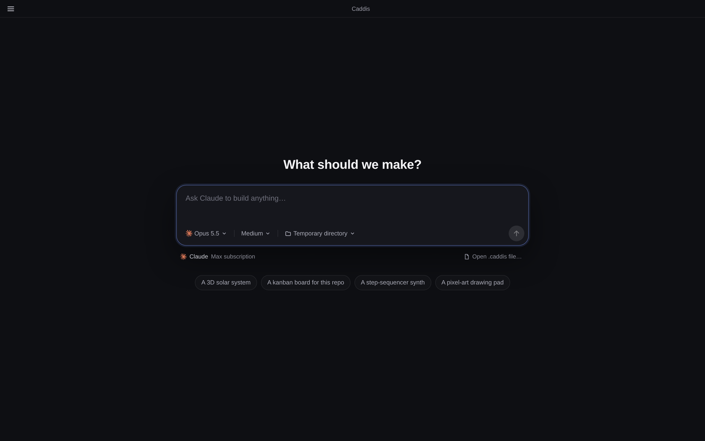
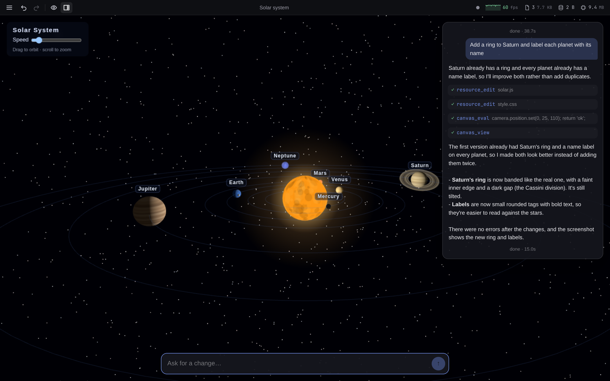

# Caddis

Caddis is a desktop app where a coding agent builds straight into the window you're looking at. Describe a page, a 2D drawing or a 3D scene, watch it appear, and keep talking to change it.

- **Builds live, in place.** The canvas updates as the agent edits it, without reloading, so a 3D scene keeps its camera and animation.
- **Uses the agents you already have.** Claude, Codex, or any [Agent Client Protocol](https://agentclientprotocol.com) agent such as opencode, Gemini CLI or Cursor. If an agent is installed and signed in, it works out of the box with your existing login.
- **A shared data store.** The page and the agent read and write the same data, so what the page saves, the agent can work with, and the other way round.
- **Interactive pages.** What you do on the page reaches the agent with your next message: tick off a task, then ask about it.
- **Save, share and open `.caddis` files.** One file holds the canvas, its data, the conversation and the files the agent wrote.
- **Pick up where you left off.** Sessions save as you go. Reopen one and the canvas, data and conversation are as you left them.
- **Undo and redo** for the canvas and the controls.
- **Works in a real folder.** The agent can read and edit files and run commands in a working directory you choose, or a fresh temporary one.





## Requirements

- [Claude Code](https://claude.com/claude-code), installed and logged in. A Pro or Max subscription works (`claude login`), and no API key is needed. On a machine without an interactive login, set `CLAUDE_CODE_OAUTH_TOKEN` from `claude setup-token`.
- Optionally, other coding agents, each installed and signed in through its own CLI. Caddis lists every one it finds and you pick one per session:
  - [Codex](https://github.com/openai/codex) (`codex login`), driven through `codex app-server`.
  - Any [Agent Client Protocol](https://agentclientprotocol.com) agent. Caddis knows how to start opencode, Gemini CLI, Cursor (`cursor-agent`), Grok Build, omp and Hermes Agent, and you can add others (see [Other agents](#other-agents)).
- Node 24 or newer, only if you run from source.

## Install and run

### Download an installer

The quickest way to start. Get one from the [latest stable release](https://github.com/mcreenan/caddis/releases/latest), or from the [nightly release](https://github.com/mcreenan/caddis/releases/tag/nightly), which is rebuilt from `main` after every merge.

| System                | File                 | Install                                   |
| --------------------- | -------------------- | ----------------------------------------- |
| macOS (Apple silicon) | `Caddis-*-arm64.dmg` | Open it and drag Caddis to Applications   |
| Debian, Ubuntu        | `caddis_*_amd64.deb` | `sudo apt install ./caddis_*_amd64.deb`   |
| Other Linux (x64)     | `Caddis-*.AppImage`  | `chmod +x Caddis-*.AppImage`, then run it |

The macOS app isn't notarized yet, so macOS blocks it the first time and may report that it's damaged. After moving it to Applications, clear the download flag once:

```sh
xattr -dr com.apple.quarantine /Applications/Caddis.app
```

### Run from source

```sh
git clone https://github.com/mcreenan/caddis.git
cd caddis
npm install
npm start
```

Ctrl/Cmd+N opens another window, which is a new session. You can also open a saved artifact directly: `npm run electron -- path/to/file.caddis`.

## Using it

1. **Start a session.** Type what the window should become. Below the prompt you can change the agent, model, effort level and working directory. The agent menu appears when more than one is installed and starts on Claude. Models and effort levels come from the agent's own login and start on its defaults. Unless you pick a folder, each session gets a new temporary directory.
2. **Watch it build.** Changes are applied in place without reloading, so 3D scenes keep their camera and animation state as Claude edits them.
3. **Keep talking.** After the first message the prompt shrinks to a single line, and the history panel shows Claude's replies and tool calls. The titlebar's history button collapses it to a small dot that pulses while Claude is working; click the dot or the button again to expand it.
4. **Interact with the canvas.** Pages Claude builds can store data and send events that Claude sees with your next message. For example, tick off a task on the page, then ask Claude about it.
5. **Let it restyle the controls.** Claude can move and restyle the prompt and history panel, within limits that keep them visible and usable.
6. **Use the titlebar.** Caddis draws its own titlebar and keeps your system's window buttons. Claude can't restyle or cover it. From left to right, it has:
   - the menu button (Windows, Linux and the web; on macOS these items are in the system menu bar):
     - **File**: new window, open, save, save as and rename
     - **Canvas**: undo, redo, reload or clear the canvas
     - **View**: show or hide the overlay, expand or minimise the history, reset the overlay's style
   - undo and redo for the canvas and the controls
   - a button that hides or shows the prompt and history (`Ctrl/Cmd+\`)
   - a button that switches the history between its normal and minimised size
   - the session's title. Claude names the session once it knows what it's building; until then the title is the first line of your first message. If the session is saved to or opened from a file, the file name is shown instead. Double-click the title (or use **File → Rename…**) to name it yourself. Claude never changes a title you set. Clear it to go back to the automatic title
   - a status readout:
     - Claude's status
     - frame rate (3D canvases)
     - number and total size of the canvas files
     - size of the data store
     - memory and, in the desktop app, CPU used by the canvas
     - watchdog warnings

Sessions are saved automatically. Reopening one restores its canvas, data and controls.

### Save and open `.caddis` files

The **File** menu (the titlebar's menu button, or the macOS menu bar) has:

| Item       | Shortcut         | What it does                                                                             |
| ---------- | ---------------- | ---------------------------------------------------------------------------------------- |
| New window | Ctrl/Cmd+N       | Opens a window with a new session (a new tab on the web)                                 |
| Open…      | Ctrl/Cmd+O       | Opens a `.caddis` file as a new session. A window still on the start card is reused      |
| Save       | Ctrl/Cmd+S       | Saves to the file this session came from or was last saved to (on the web, downloads it) |
| Save as…   | Ctrl/Cmd+Shift+S | Saves to a new file                                                                      |

A `.caddis` file is a zip archive you can inspect with any unzip tool:

| Path                                        | Contents                                                                                                                                |
| ------------------------------------------- | --------------------------------------------------------------------------------------------------------------------------------------- |
| `manifest.json`                             | Format version, title, model and working directory, a summary (turns, tool calls, cost), and every file below with its size and SHA-256 |
| `data.json`                                 | The data store shared by Claude and the page                                                                                            |
| `history.json`                              | The conversation as shown in the history panel                                                                                          |
| `canvas/…`                                  | Every canvas file: `index.html`, stylesheets, modules and assets                                                                        |
| `claude/transcript.jsonl`                   | Claude Code's transcript, so Claude remembers the conversation after you open the file (Claude sessions only)                           |
| `workspace/…`                               | Files Claude created or edited in the working directory with its file tools. Changes made by shell commands aren't tracked              |
| `chrome.json`, `activity.json`, `undo.json` | Control styling, canvas activity, and undo/redo history                                                                                 |
| `preview.png`                               | A screenshot of the window when it was saved                                                                                            |

When you open a file:

- The session keeps its original working directory if that folder exists on this machine. Otherwise it uses `CADDIS_DEFAULT_CWD` or a new temporary directory.
- Workspace files are written back only into the original folder, and only when they're missing. Existing files are never overwritten.
- Claude continues from a copy of the saved conversation, so the original session is left unchanged.
- Other agents keep their conversations in their own stores, so the file can't carry them. On the machine that saved it, the agent continues from a fork of its conversation (or the conversation itself if it can't fork). Elsewhere it starts fresh with the canvas, data and history intact.
- The archive is checked against its manifest, and a file that doesn't match is rejected.

### What Claude can do

In its working directory, Claude can read and edit files and run shell commands without asking. Commands run in Claude Code's sandbox, which allows writes only inside the working directory and allows network access. Canvas pages are sandboxed from the app but can reach the network.

Codex works the same way in its `workspace-write` sandbox with network access, and never stops to ask for approval: anything outside the sandbox is declined.

ACP agents apply their own settings, and Caddis answers their permission requests because there is no approval UI yet. It allows the canvas tools, reading, searching and fetching, and edits to files inside the working directory. It refuses everything else, including shell commands the agent asks about, and says so in the history. Set `CADDIS_ACP_PERMISSIONS=all` to allow everything.

The canvas tools reach Codex and ACP agents through an MCP server that Caddis serves on a random loopback port, under a secret path for each session.

### Other agents

To add an ACP agent Caddis doesn't know, list it in `acp-agents.json` in the data directory (`CADDIS_DATA_DIR`), or in `CADDIS_ACP_AGENTS` as JSON or the path to a JSON file:

```json
[
  {
    "id": "my-agent",
    "label": "My Agent",
    "command": "my-agent",
    "args": ["--acp"],
    "env": { "MY_AGENT_MODE": "fast" }
  }
]
```

An entry with the same `id` as a known agent (`opencode`, `gemini`, `cursor`, `grok`, `omp`, `hermes-agent`) replaces it. Models and effort levels come from the agent's session config options when it offers them.

### Use it from another device

`npm run web` serves Caddis at `http://<this-machine>:5317` for browsers on your LAN or tailnet. It has **no authentication**, and Claude can run commands on this machine, so use it only on networks you trust.

### Settings

| Variable                             | Purpose                                                                                                      |
| ------------------------------------ | ------------------------------------------------------------------------------------------------------------ |
| `CADDIS_DEFAULT_CWD`                 | Default working directory (a new temporary directory for each session)                                       |
| `CADDIS_DATA_DIR`                    | Where sessions are stored                                                                                    |
| `CADDIS_CLAUDE_EXECUTABLE`           | Path to `claude`, if it isn't on `PATH`                                                                      |
| `CADDIS_CODEX_EXECUTABLE`            | Path to `codex`, if it isn't on `PATH`                                                                       |
| `CADDIS_ACP_AGENTS`                  | Extra ACP agents, as JSON or a file path (see [Other agents](#other-agents))                                 |
| `CADDIS_ACP_PERMISSIONS`             | `all` lets ACP agents do anything they ask permission for                                                    |
| `CADDIS_PERMISSION_MODE`             | Claude permission mode (default `acceptEdits`)                                                               |
| `CADDIS_SANDBOX`                     | `0` turns off the command sandbox. Claude's commands then need pre-approval, and Codex runs with full access |
| `CADDIS_SESSION` or `--session=<id>` | Reopen a specific session                                                                                    |
| `HOST`, `PORT`                       | Web server address (`0.0.0.0`, `5317`)                                                                       |

## Development

The toolchain is [Vite+](https://viteplus.dev) (`vp`): one `vite.config.ts` covers the dev server, builds, formatting, linting, type checking and tests.

```sh
npm run dev         # Electron with hot reload (vp dev)
npm run check       # format, lint and type-check (vp check); `npm run fix` applies fixes
npm test            # unit tests (vp test)
npm run e2e         # end-to-end test with real Claude turns (TARGET=web for the web build)
npm run dist        # installer for this OS in dist/ (also dist:linux, dist:mac)
```

| Path           | Contents                                                       |
| -------------- | -------------------------------------------------------------- |
| `src/main`     | Electron main process                                          |
| `src/preload`  | Preload bridge (`window.caddis`)                               |
| `src/renderer` | React UI: chrome, prompt and history                           |
| `src/canvas`   | Runtime served into the sandboxed canvas frame                 |
| `src/core`     | Sessions, agent providers, tools and artifacts, shared by both |
| `src/server`   | Standalone web server (`npm run web`)                          |
| `src/shared`   | Types shared across processes                                  |
| `e2e`          | End-to-end test                                                |

A pre-push hook runs `vp check` and `vp test`.

### Releases

Installers are Linux (AppImage, deb) and macOS (dmg, ad-hoc signed but not notarized, Apple silicon), published on [GitHub Releases](https://github.com/mcreenan/caddis/releases):

- **Nightly**: every merge to `main` replaces the `nightly` prerelease, versioned as the next patch (e.g. `0.2.1-nightly.42`).
- **Stable**: run the **Release** workflow (Actions → Release → Run workflow, or `gh workflow run release.yml -f bump=minor`). It checks `main`, bumps the version, tags `vX.Y.Z`, builds the installers and publishes the release with generated notes.
